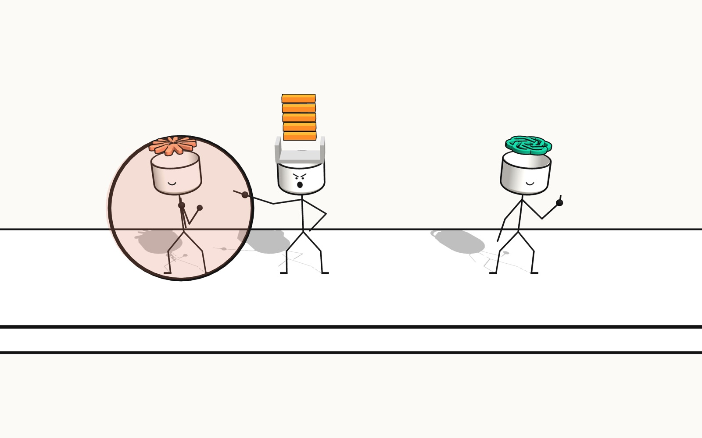

# Bot Battle

**Live:** [mpts.ie/games/botbattle](https://mpts.ie/games/botbattle/)

Stack Overflow, ChatGPT and Claude settle it on a sheet of paper. It's a 3D stick-figure fighting game in the browser, built from a meme: the angry Stack Overflow guy pointing at the two chatbots giving a thumbs up.


## Videos

| [Showcase: three bots, one sheet of paper](promo/out/01-showcase.mp4) | [Devlog: what the inhale eats](promo/out/02-inhale.mp4) |
|---|---|
| [](promo/out/01-showcase.mp4) | [](promo/out/02-inhale.mp4) |

Both are made in [`promo/`](promo/) with TapaTab (recording) and ShadowKit (compositing, narration, music): `takes.mjs` stages each scene in training mode, and `videos/<id>/edl.js` is each video's edit list.

## Modes


| Mode | What it is |
|---|---|
| Free-for-all | You against both CPUs at once. Last one standing wins. |
| Duel | One on one. Pick yourself, then pick your opponent. |
| Training | Play-test one fighter against two dummies. Dummies refill their health, knockouts respawn, and you can make the dummies stand still, move around or fight back. |
| Watch | Three CPUs fight while you watch. |

Fighters are picked from a carousel: rotate with the arrow buttons, the arrow keys, a drag or the mouse wheel. Each card has its fighter standing on top in 3D, and the one in the middle shows off a move every few seconds.


## Controls

| Key | Action |
|---|---|
| `A` `D` or `←` `→` | Move |
| `W`, `↑` or `Space` | Jump (ChatGPT and Claude can double jump) |
| `J` `K` `L` `I` (or `1`–`4`) | Abilities |
| Hold `Backspace` | Shield. Let go just before a hit lands to parry |
| `Esc` | Back to the menu |

On phones, the same controls appear as on-screen buttons.


The stage has edges. Walk off, or get knocked off, and you're out.


## The fighters

### Stack Overflow

Carries five orange blocks on a spring above its head. The spring is invisible and bends as one piece, left or right only.

| Key | Move | |
|---|---|---|
| `J` | **Block shot** | Rapid fire. The blocks rest at the bottom of the stack; the top one slides up and flies off the end, and new ones drop in on top. 3 damage each. Hold `J` to keep firing. |
| `K` | **Unified beam** | The stack bends toward the enemy like a barrel, and all five blocks feed up it into one glowing beam. |
| `L` | **Block whip** | The spring stretches out to the length of Claude's fling and lashes the blocks forward, bending at the base first. |
| `I` | **Correction** | A condescending remark ("Please provide a minimal reproducible example.") that stuns everyone nearby. |


### ChatGPT

Its logo spins on top of its head like rotor blades. On a double jump the blades spin up and pull it upward.

| Key | Move | |
|---|---|---|
| `J` | **Computer use** | A homing mouse cursor: off-white, with a green outline and glow. |
| `K` | **Computer use (advanced)** | A bigger cursor. Whoever it hits glows green and is yours to control for 2 seconds. |
| `L` | **Inhale** | ChatGPT tilts its head forward, the logo grows and spins up a tornado that sucks in enemies and their attacks. Builds **context**. |
| `I` | **Compaction** | Spends 50% context to flatten everyone in front of it and deal some damage. Flattened fighters grow back slowly, and faster as they land hits. |


Inhale reacts differently to each attack it swallows:

| Swallowed | What happens | Context |
|---|---|---|
| Stack Overflow's blocks | Spin wildly, shrink, and shred into confetti at the mouth | +8 |
| Stack Overflow's beam | Ends at ChatGPT's mouth with a green flare instead of hitting it | +10 per block fed |
| Stack Overflow's whip | ChatGPT yanks a block off the end and eats it ("Yoink") | +8 |
| Stack Overflow's Correction | ChatGPT isn't stunned; the words come loose from the speech bubble one by one and fly into its mouth | +20 |
| Claude's rods | Turn to point at the mouth and stretch thin like spaghetti | +12 |
| Claude's fling | The rod gets ripped off mid-poke and slurped ("Slurp") | +12 |
| Claude's dots | Pulled out of formation; each one circles the mouth before it goes in | +6 |
| Fighters | Pulled toward the mouth and chomped while they're close | +7/s, +4 per chomp |

### Claude

Its logo is the real Claude mark, split into its 12 rays along their seams, with one outline around the outside so it still reads as a single mark.

| Key | Move | |
|---|---|---|
| `J` | **Combobulating** | Alternates between three dots in a line (the outer two smaller) and four in a square (one diagonal smaller). The dots bob and trail Claude on springs, and Claude punches them out one at a time, alternating hands. |
| `K` | **Fling** | One rod leaves the logo and pokes forward. It's gone until it grows back. |
| `L` | **Shoot** | Rapid fire: the logo's rods fly off one after another, light damage with full knockback. Hold `L` to keep firing. Rods grow back one per second. |


## Shield and parry

Parry works like *Super Smash Bros. Ultimate*. Hold `Backspace` to raise a shield. It shrinks as it soaks up hits and breaks if it runs out. Letting go starts an 11-frame shield drop, and the first 5 frames of that drop are the parry window. A parry takes no damage, freezes the action for a moment, skips the rest of the shield drop, and leaves a nearby attacker stuck for 0.6 seconds. Hits that land after the window connect normally.



## Knockouts

Knocked-out fighters go limp as a ragdoll: their joints are linked points under gravity, tumbling and settling on the paper.


## Results

Each match ends with a benchmark-style table, laid out like the ones in AI model announcements. The winner's column is outlined, and the best score in each row is highlighted.


## Training


## How it's built

- One HTML file, [`game/stick-standoff.html`](game/stick-standoff.html), using [three.js](https://threejs.org/) r128 from a CDN. It's the same file that's published as a Claude artifact.
- Logos are extruded from their SVG outlines and get the same ink outline as the heads: a back-facing copy pushed out along smoothed normals.
- Walking uses planted feet with two-bone IK. A foot that's carrying weight never slides.
- The block stack and the logo stalks are springs simulated as a single bending angle, so each one bends as a whole.

## Run and deploy

```bash
npm install
npm run dev      # build the page and serve it locally
npm run deploy   # build the page and deploy the worker to mpts.ie/games/botbattle
```

`npm run build:page` wraps `game/stick-standoff.html` into a full page at `public/games/botbattle/index.html`. A small Cloudflare Worker ([`src/index.ts`](src/index.ts)) serves it at `mpts.ie/games/botbattle` and redirects the bare path to the trailing-slash URL.
